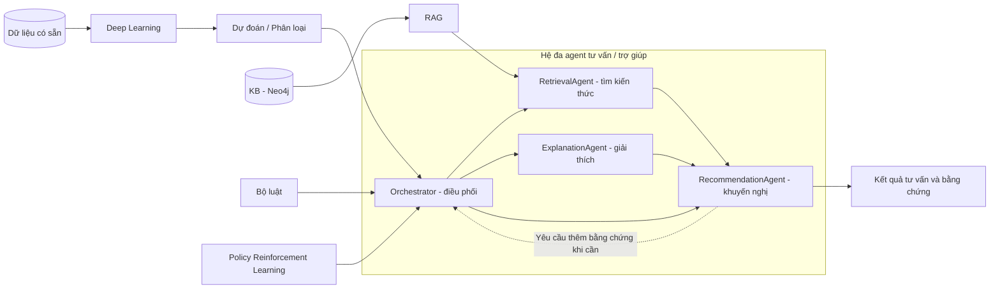

# Kế hoạch hoàn thiện hệ đa agent hỗ trợ bệnh tiểu đường

## Kiến trúc cần bám theo

Giữ các agent hiện có và Orchestrator điều phối. Bổ sung deep learning, KB Neo4j, RAG, luật và RL theo kiến trúc trong ảnh. Sơ đồ dưới đây là kiến trúc mục tiêu.

Phát triển, huấn luyện và demo trên máy cá nhân: dữ liệu trong `data/`, pipeline trong `models/`, kết quả trong `artifacts/`.

## Các việc cần làm theo thứ tự

### Bước 1 — Rà soát bài toán và hệ hiện tại

- [x] Kiểm tra mục tiêu, nhãn dữ liệu, đầu vào/đầu ra và luồng phối hợp agent.
- [x] Ghi kết luận tại [Kết quả rà soát Bước 1](docs/pham_vi_du_lieu_va_hop_dong.md).

### Bước 2 — Sửa môi trường và đầu vào API

- [x] Thiết lập dependencies backend/frontend theo phiên bản dự án.
- [x] Sửa lỗi `float(None)` khi nhập BMI; kiểm tra phải có BMI hoặc đủ chiều cao/cân nặng; trả lỗi 422 và kiểm thử các trường hợp này.
- [x] Chuyển đường dẫn và luồng huấn luyện sang local; bỏ script và cấu hình chạy Kaggle.

Kiểm tra: 14 tests đạt, coverage 62,2%; Python lint/format và frontend lint/typecheck/build đều đạt. GPU MLP, RL thử nghiệm, Neo4j và luồng web → API/RAG đã chạy local.

### Bước 3 — Sửa dữ liệu và đánh giá mô hình

- [x] Chế độ nhị phân chỉ tự chọn CSV có `Diabetes_binary` và kiểm tra nhãn 0/1; hỗ trợ `012` sẽ là chế độ ba lớp riêng nếu cần mở rộng.
- [ ] Chọn mô hình và ngưỡng trên train/validation; dùng test đánh giá cuối cùng, rồi cập nhật metrics.
- [ ] Kiểm tra ánh xạ đặc trưng, nhất là `bp → HighBP`; xác định riêng ngưỡng nhị phân và các mức Low/Medium/High.

### Bước 4 — Bổ sung deep learning

- [ ] Huấn luyện MLP, so sánh với các mô hình nền và lưu mô hình cùng tiền xử lý.
- [ ] Tích hợp dự đoán vào Orchestrator; trả xác suất, nhãn và phiên bản mô hình.

### Bước 5 — Chạy đúng mô hình đã huấn luyện

- [ ] Cung cấp artifact và kiểm tra tải được khi khởi động.
- [ ] Báo rõ khi thiếu mô hình; chỉ dùng CSV 12 dòng trong chế độ thử nghiệm; hiển thị đúng mô hình đang chạy.

### Bước 6 — Xây KB Neo4j

- [ ] Thiết kế đồ thị tri thức về tiểu đường, thu thập tài liệu có nguồn và viết script nạp/cập nhật dữ liệu.
- [ ] Thêm cấu hình Neo4j và truy vấn được quan hệ cùng bằng chứng.

### Bước 7 — Hoàn thiện RAG

- [ ] Thay embedding băm bằng embedding ngữ nghĩa; kết nối RetrievalAgent với KB Neo4j.
- [ ] Dùng nội dung truy xuất để tạo khuyến nghị có nguồn; xử lý thiếu bằng chứng và đánh giá độ liên quan.

### Bước 8 — Hoàn thiện bộ luật

- [ ] Tổ chức luật với điều kiện, mã luật, mức ưu tiên và căn cứ.
- [ ] Xử lý xung đột giữa dự đoán, bằng chứng và cảnh báo; kiểm thử các luật.

### Bước 9 — Bổ sung reinforcement learning

- [ ] Xác định state/action/reward cho việc chọn bước hỗ trợ tiếp theo; xây môi trường và huấn luyện policy.
- [ ] So sánh với chiến lược cố định, ghi rõ phản hồi thực hay mô phỏng và tích hợp policy vào Orchestrator.

### Bước 10 — Hoàn thiện phối hợp agent

- [ ] Truyền đủ bằng chứng và kết quả giải thích giữa các agent; xử lý thiếu dữ liệu, thiếu bằng chứng và lỗi công cụ.
- [ ] Kiểm tra câu trả lời cuối, lưu dấu vết thực thi; nếu demo hội thoại thì thay phản hồi cố định của `/chat`.

### Bước 11 — Sửa giải thích, độ tin cậy và memory

- [ ] Giải thích theo đúng đặc trưng mô hình và đúng phương pháp SHAP/sensitivity; glucose không tham gia mô hình BRFSS hiện tại.
- [ ] Làm rõ `confidence_score` là điểm chất lượng dữ liệu nếu vẫn tính bằng heuristic; tính cả trường tự điền.
- [ ] Cải thiện tìm ca tương tự; phân biệt dự đoán lưu trong memory với kết quả bệnh thực tế.

### Bước 12 — Kiểm thử và demo

- [ ] Chạy kiểm thử backend, lint/typecheck/build frontend và toàn bộ luồng tích hợp.
- [ ] Demo hồ sơ đủ/thiếu dữ liệu, cảnh báo, thiếu bằng chứng và lỗi dịch vụ; thể hiện vai trò từng thành phần.

### Bước 13 — Hoàn thiện báo cáo

- [ ] Bám bố cục: giới thiệu → hệ đa agent → kiến trúc → các thành phần → code và demo.
- [ ] Cập nhật README, sơ đồ, model card và ảnh/video theo phiên bản thực tế.
