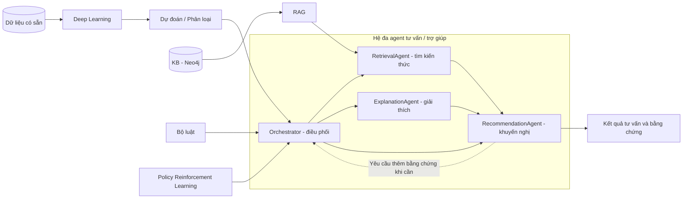

# Kế hoạch hoàn thiện hệ đa agent hỗ trợ bệnh tiểu đường

## Kiến trúc cần bám theo

Giữ các agent hiện có và Orchestrator điều phối. Bổ sung deep learning, KB Neo4j, RAG, luật và RL theo kiến trúc trong ảnh. Sơ đồ dưới đây là kiến trúc mục tiêu.

Phát triển, huấn luyện và demo trên máy cá nhân: dữ liệu trong `data/`, pipeline trong `models/`, kết quả trong `artifacts/`.

## Các việc cần làm theo thứ tự

### Bước 1 — Rà soát bài toán và hệ hiện tại

- [x] Kiểm tra mục tiêu, nhãn dữ liệu, đầu vào/đầu ra và luồng phối hợp agent.
- [x] Ghi kết luận tại [Kết quả rà soát Bước 1](docs/pham_vi_du_lieu_va_hop_dong.md).

### Bước 2 — Sửa môi trường và đầu vào API

- [x] Thiết lập dependencies backend/frontend theo phiên bản dự án.
- [x] Sửa lỗi `float(None)` khi nhập BMI; kiểm tra phải có BMI hoặc đủ chiều cao/cân nặng; trả lỗi 422 và kiểm thử các trường hợp này.
- [x] Chuyển đường dẫn và luồng huấn luyện sang local; bỏ script và cấu hình chạy Kaggle.

Kiểm tra: 14 tests đạt, coverage 62,2%; Python lint/format và frontend lint/typecheck/build đều đạt. GPU MLP, RL thử nghiệm, Neo4j và luồng web → API/RAG đã chạy local.

### Bước 3 — Sửa dữ liệu và đánh giá mô hình

- [x] Chế độ nhị phân chỉ tự chọn CSV có `Diabetes_binary` và kiểm tra nhãn 0/1; hỗ trợ `012` sẽ là chế độ ba lớp riêng nếu cần mở rộng.
- [x] Chọn mô hình và ngưỡng trên validation (chia 60/20/20); test chỉ đánh giá cuối cùng; đã cập nhật `artifacts/metrics.json` và model card.
- [x] Kiểm tra ánh xạ đặc trưng, nhất là `bp → HighBP`; xác định riêng ngưỡng nhị phân và các mức Low/Medium/High. Chi tiết tại [Ánh xạ đặc trưng và ngưỡng rủi ro](docs/anh_xa_dac_trung_va_nguong_rui_ro.md).

### Bước 4 — Bổ sung deep learning

- [x] Huấn luyện MLP (`models/mlp.py`, PyTorch GPU), so sánh với 4 mô hình nền bằng cùng quy trình CV → validation → test; lưu cùng `StandardScaler` trong một Pipeline đã hiệu chuẩn. Dự đoán chạy bằng NumPy nên không cần torch khi triển khai.
- [x] Orchestrator trả thêm khối `prediction` gồm xác suất, nhãn nhị phân (theo ngưỡng validation), mức rủi ro, tên và `model_version` của mô hình.

Kết quả: MLP đứng thứ 2 theo CV (0,8305) nên được tuning, và được chọn theo validation AUC (0,8283 so với 0,8278 của hist_gradient_boosting). Chênh lệch này nằm trong nhiễu; trên test MLP đạt 0,8258 so với 0,8266, nên MLP và các mô hình boosting tương đương. Do MLP chiếm suất tuning thứ 2, LightGBM chạy tham số mặc định lần này.

### Bước 5 — Chạy đúng mô hình đã huấn luyện

- [x] Cung cấp artifact và kiểm tra tải được khi khởi động.

### Bước 6 — Xây KB Neo4j

- [x] Thiết kế đồ thị tri thức về tiểu đường, thu thập tài liệu có nguồn và viết script nạp/cập nhật dữ liệu.
- [x] Thêm cấu hình Neo4j và truy vấn được quan hệ cùng bằng chứng.

Chi tiết tại [Knowledge graph Neo4j](docs/neo4j_kb.md): 20 thực thể, 35 quan hệ, 21 bằng chứng từ 5 nguồn; kiểm thử bằng driver giả, chưa chạy trên server Neo4j thật (máy chưa bật Docker).

### Bước 7 — Hoàn thiện RAG

- [x] Thay embedding băm bằng embedding ngữ nghĩa; kết nối RetrievalAgent với KB Neo4j.
- [x] Dùng nội dung truy xuất để tạo khuyến nghị có nguồn; xử lý thiếu bằng chứng và đánh giá độ liên quan.

Chi tiết: embedding `sentence-transformers/all-MiniLM-L6-v2` (`tools/semantic_embeddings.py`); `RetrievalAgent` nạp 21 đoạn bằng chứng từ Neo4j (hoặc từ file KB khi Neo4j không kết nối được), tìm theo độ tương đồng cosine, cộng điểm cho bằng chứng mà đồ thị gắn với yếu tố nguy cơ của bệnh nhân. Mỗi đoạn có `relevance`, nguồn và URL; dưới ngưỡng 0,3 bị loại. Kết quả có `evidence_status` (none/limited/sufficient); khuyến nghị đánh số trích dẫn `[n]` kèm danh sách nguồn, và nói rõ khi thiếu bằng chứng. Chưa chạy trên server Neo4j thật; ngưỡng liên quan mới đặt theo vài ca thử, chưa hiệu chỉnh trên tập đánh giá.

### Bước 8 — Hoàn thiện bộ luật

- [x] Tổ chức luật với điều kiện, mã luật, mức ưu tiên và căn cứ.
- [x] Xử lý xung đột giữa dự đoán, bằng chứng và cảnh báo; kiểm thử các luật.

Chi tiết tại [Bộ luật an toàn và xử lý xung đột](docs/bo_luat.md): 6 luật cơ sở và 5 luật xung đột trong `tools/rules.py`; số đo thắng dự đoán (`effective_risk`), chuyển tuyến lấy mức nặng nhất và không bị hạ vì thiếu bằng chứng. Luật glucose chỉ áp dụng cho giá trị đo thật. 63 tests đạt (17 test mới cho luật). Ngưỡng là ngưỡng của dự án, chưa được bác sĩ thẩm định.

### Bước 9 — Bổ sung reinforcement learning

- [x] Xác định state/action/reward cho việc chọn bước hỗ trợ tiếp theo; xây môi trường và huấn luyện policy.
- [x] So sánh với chiến lược cố định, ghi rõ phản hồi thực hay mô phỏng và tích hợp policy vào Orchestrator.

Chi tiết tại [Policy RL](docs/reinforcement_learning.md): Q-learning dạng bảng trên môi trường mô phỏng (không có phản hồi thật). Reward trung bình: Q-learning 0,956, bảng kiểm cố định 0,946 (chênh lệch trong sai số), chỉ theo rủi ro 0,803, ngẫu nhiên −0,367. Policy được Orchestrator gọi; luật an toàn luôn có quyền ưu tiên. 73 tests đạt.

### Bước 10 — Hoàn thiện phối hợp agent

- [x] Truyền đủ bằng chứng và kết quả giải thích giữa các agent; xử lý thiếu dữ liệu, thiếu bằng chứng và lỗi công cụ.

Orchestrator giờ truyền kết quả giải thích đặc trưng cho agent khuyến nghị, và truyền kết quả luật an toàn cùng trạng thái bằng chứng cho agent giải thích (agent này chạy sau cùng nên thấy kết quả cuối). Lỗi của retriever, tìm/lưu memory, giải thích đặc trưng, agent giải thích và agent khuyến nghị không làm hỏng cả yêu cầu: lỗi được ghi vào `degraded` trong kết quả, thêm lời cảnh báo "kết quả chưa đầy đủ", và nội dung được thay bằng văn bản dự phòng. Nếu bộ luật an toàn lỗi thì kết quả nghiêng về chuyển bác sĩ (`prompt_clinician_followup`, độ tin cậy Low), không coi là "an toàn". Thiếu glucose và thiếu bằng chứng đã được xử lý ở các bước trước. 83 tests đạt (10 test mới trong `tests/test_orchestrator.py`).

### Bước 11 — Sửa giải thích, độ tin cậy và memory

- [x] Giải thích theo đúng đặc trưng mô hình và đúng phương pháp SHAP/sensitivity; glucose không tham gia mô hình BRFSS hiện tại.
- [x] Làm rõ `confidence_score` là điểm chất lượng dữ liệu nếu vẫn tính bằng heuristic; tính cả trường tự điền.
- [x] Cải thiện tìm ca tương tự; phân biệt dự đoán lưu trong memory với kết quả bệnh thực tế.

Mô hình đang dùng là MLP nên giải thích luôn là sensitivity (thay từng đặc trưng bằng giá trị mặc định); SHAP chỉ áp dụng cho mô hình tuyến tính. Kết quả giải thích có `method_note`, `inputs_not_in_model` (glucose) và cờ `defaulted` cho đặc trưng do hệ thống tự điền; văn bản giải thích chỉ nêu các đặc trưng thật sự tác động và không còn gán "high glucose" cho mô hình. `confidence_score` giữ nguyên tên trường nhưng thêm `confidence_note` nêu rõ đây là điểm chất lượng dữ liệu chứ không phải độ tin cậy thống kê, trừ theo tỉ lệ trường tự điền trên tổng số trường tùy chọn (tối đa `DATA_QUALITY_MAX_PENALTY`, mặc định 0,2) cùng `defaulted_fields`; giao diện đổi nhãn thành "Data quality". Tìm ca tương tự xếp theo khoảng cách số (tuổi, BMI, huyết áp, glucose khi cả hai đều đo) và loại ca quá xa; thang đo tuổi/BMI lấy từ độ lệch chuẩn dữ liệu huấn luyện, còn huyết áp/glucose (không có trong dữ liệu huấn luyện) và ngưỡng loại ca đặt trong cấu hình; mỗi ca mang `outcome_confirmed = false`. 93 tests đạt, typecheck và lint frontend sạch.

### Bước 12 — Kiểm thử và demo

- [ ] Chạy kiểm thử backend, lint/typecheck/build frontend và toàn bộ luồng tích hợp.
- [ ] Demo hồ sơ đủ/thiếu dữ liệu, cảnh báo, thiếu bằng chứng và lỗi dịch vụ; thể hiện vai trò từng thành phần.

### Bước 13 — Hoàn thiện báo cáo

- [ ] Bám bố cục: giới thiệu → hệ đa agent → kiến trúc → các thành phần → code và demo.
- [ ] Cập nhật README, sơ đồ, model card và ảnh/video theo phiên bản thực tế.
