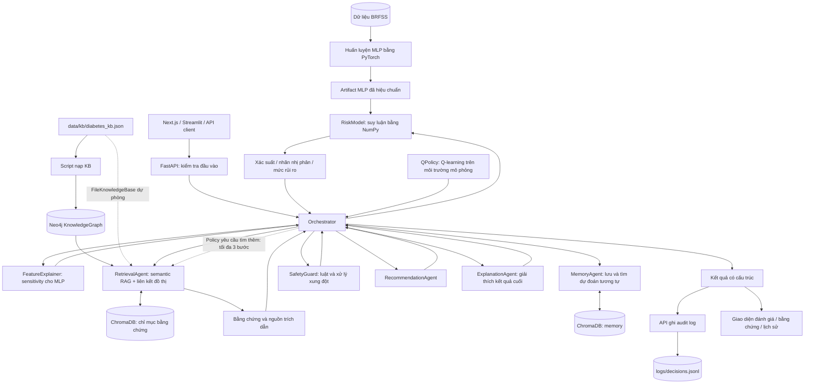

# Kiến trúc hệ đa agent hỗ trợ bệnh tiểu đường

Hệ thống kết hợp MLP dự đoán, KB/RAG cung cấp bằng chứng, bộ luật xử lý cảnh báo và Q-learning chọn bước hỗ trợ tiếp theo. Orchestrator điều phối các agent để trả giải thích, khuyến nghị và nguồn tham khảo.

## Kiến trúc tổng quan

## Các thành phần

| Thành phần | Vai trò và mã nguồn |
|---|---|
| Dữ liệu và huấn luyện | 253.680 mẫu, 21 đặc trưng BRFSS; chia train/validation/test 60/20/20; `models/training_pipeline.py`, `models/mlp.py`. Chọn mô hình và ngưỡng bằng validation, đánh giá cuối trên test. |
| RiskModel | `models/risk_model.py` nạp `artifacts/risk_model.joblib`. Artifact hiện tại là MLP đã hiệu chuẩn; trả xác suất, nhãn theo ngưỡng 0,23906 và mức rủi ro. Glucose không thuộc đầu vào mô hình BRFSS. |
| Orchestrator | `agents/orchestrator.py` điều phối, truyền bằng chứng, giải thích đặc trưng và kết quả luật; ghi nhận lỗi thành phần trong `degraded`. |
| RetrievalAgent | `agents/retriever.py` dùng `all-MiniLM-L6-v2`, chỉ mục ChromaDB và liên kết KB để xếp hạng bằng chứng; trả nguồn, URL, độ liên quan và trạng thái none/limited/sufficient. |
| KB | `tools/neo4j_kb.py`: KnowledgeGraph truy vấn Neo4j; FileKnowledgeBase đọc JSON khi chưa cấu hình hoặc không kết nối được đồ thị lúc khởi tạo. KB có 20 thực thể, 35 quan hệ nghiệp vụ, 21 bằng chứng và 5 nguồn. |
| SafetyGuard và luật | `tools/safety.py`, `tools/rules.py`: cảnh báo, mức chuyển tuyến, xử lý xung đột và điểm chất lượng dữ liệu. Luật có quyền ưu tiên so với dự đoán và policy RL. |
| QPolicy | `rl/policy.py`, `rl/environment.py`: Q-learning lưu tại `artifacts/support_policy.json`; chọn hỏi glucose, truy xuất thêm, khuyến nghị hoặc chuyển bác sĩ. Huấn luyện bằng phản hồi mô phỏng. |
| RecommendationAgent | `agents/recommender.py` nhận bằng chứng, ca tương tự, tác động đặc trưng và kết quả luật để tạo khuyến nghị có trích dẫn; dùng OpenAI khi có key, văn bản dự phòng khi không có key hoặc lỗi LLM. |
| ExplanationAgent | `agents/explainer.py` chạy sau cùng để giải thích theo kết quả luật và trạng thái bằng chứng cuối; hỗ trợ LLM và văn bản dự phòng. |
| FeatureExplainer | `tools/explainability.py`: sensitivity đối với MLP hiện tại, SHAP chỉ cho mô hình tuyến tính; đánh dấu trường tự điền và đầu vào không thuộc mô hình. |
| MemoryAgent | `memory/store.py`: lưu dự đoán và tìm hồ sơ tương tự bằng khoảng cách các chỉ số; `outcome_confirmed=false`, không coi dự đoán cũ là kết quả bệnh đã xác nhận. |
| API và giao diện | `api/app.py`, `web/`, `ui/app.py`: kiểm tra dữ liệu, dự đoán, hiển thị đánh giá/bằng chứng/lịch sử. Next.js gọi backend qua các route proxy. API ghi audit bằng `tools/audit_logger.py`. |

## Trình tự xử lý một yêu cầu

1. API kiểm tra dữ liệu; RiskModel chuẩn hóa, tính BMI khi cần và ghi nhận trường tự điền.
2. MLP dự đoán; hệ thống xác định nhãn nhị phân và mức rủi ro theo ngưỡng trong artifact.
3. Tính sensitivity của đặc trưng, tìm ca tương tự và truy xuất bằng chứng KB/RAG.
4. Đánh giá trạng thái bằng chứng, áp dụng bộ luật, sau đó tạo khuyến nghị.
5. Nếu có policy, Orchestrator chạy tối đa 3 bước. Tìm thêm bằng chứng thực sự gọi lại retriever, luật và agent khuyến nghị. Yêu cầu đo glucose được trả về làm bước tiếp theo để người dùng thực hiện.
6. Luật giữ quyền ưu tiên: policy không được hạ mức chuyển tuyến đã được luật yêu cầu.
7. Agent giải thích nhận kết quả cuối; MemoryAgent lưu dự đoán. API ghi audit và trả kết quả cho giao diện.

Lỗi thành phần tùy chọn có nội dung dự phòng và được công bố trong `degraded`. Lỗi bộ luật yêu cầu bác sĩ đánh giá; lỗi mô hình không tạo xác suất giả. `confidence_score` là điểm chất lượng dữ liệu theo heuristic, không phải độ tin cậy thống kê.

## Cấu hình và đánh giá

- Có `NEO4J_PASSWORD`: thử kết nối Neo4j theo `NEO4J_URI`; không có thì đọc KB file. Script `scripts/load_neo4j_kb.py` nạp dữ liệu trước khi chạy RAG trên đồ thị.
- Không có `OPENAI_API_KEY`: vẫn chạy được dự đoán, KB/RAG, luật, policy, memory và hai agent tạo văn bản bằng nội dung dự phòng.
- MLP hiện tại: test ROC AUC 0,82581, F1 0,46543; xem [model card](../artifacts/model_card.md).
- RL dùng phản hồi mô phỏng; xem [môi trường và đánh giá policy](reinforcement_learning.md).
- Cách chạy và bằng chứng kiểm tra: [kiểm thử và demo](kiem_thu_va_demo.md), [KB Neo4j](neo4j_kb.md).
- Luồng bổ sung dữ liệu tương tác và thang chỉ số có nguồn: [hỏi bổ sung và thang đo](hoi_bo_sung_va_thang_do.md). API trả thêm `followup` và `measurement_scales`; trạng thái chưa có số đo được truyền vào policy để tránh hỏi lặp.
