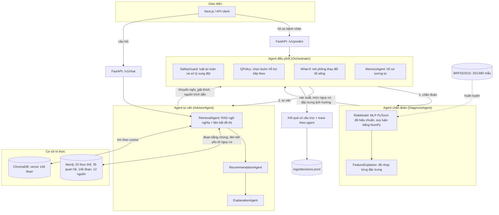
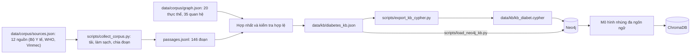

# Kiến trúc hệ đa agent hỗ trợ bệnh tiểu đường

Hệ thống có ba vai trò. **Agent chẩn đoán** chạy mô hình Deep Learning (MLP). **Agent tư vấn** dùng RAG trên cơ sở tri thức (KB) Neo4j để đưa khuyến nghị có trích dẫn. **Agent điều phối** nối hai agent trên, áp dụng bộ luật an toàn và chính sách Q-learning. Ngoài ra người dùng có thể hỏi đáp trực tiếp với KB qua chat RAG.

## Kiến trúc tổng quan

## Đối chiếu với tài liệu kiến trúc (`docs/pdf/project_architecture_multiagent_diabet_v1.pdf`)

PDF mô tả 8 agent; mã nguồn gộp một số vai trò thành công cụ do Orchestrator gọi. Bảng dưới nói rõ phần nào là agent thật, phần nào chỉ là thành phần, để không nhận quá mức khi vấn đáp.

| Agent trong PDF | Trong mã nguồn | Ghi chú |
|---|---|---|
| Patient Data Agent | `PatientRequest` (Pydantic) trong `api/app.py` + `RiskModel.assess` | Không phải agent riêng: kiểm tra đầu vào và điền giá trị mặc định ở API/mô hình. Dữ liệu sai trả HTTP 422 và dừng luồng. |
| DL Prediction Agent | `agents/diagnosis_agent.py` (`DiagnosisAgent`) | Agent thật; gọi MLP đã huấn luyện. |
| Rule-Based Agent | `tools/rules.py`, `tools/safety.py` (`SafetyGuard`) | Thành phần do Orchestrator gọi, không phải agent độc lập. |
| KG/RAG Agent | `agents/retriever.py` (`RetrievalAgent`), nằm trong `AdvisorAgent` | Agent thật. |
| Coordinator Agent | `agents/orchestrator.py` (`Orchestrator`) | Agent thật; sinh/nhận `request_id`, chạy trace. |
| Explanation Agent | `agents/explainer.py`, `agents/recommender.py` | Agent thật (qua `AdvisorAgent`). |
| Monitoring / Audit Agent | `RunLog` trong `agents/orchestrator.py` + `tools/audit_logger.py` | Không phải agent riêng: ghi vết từng bước và audit log. |
| RL Agent | `rl/` (`QPolicy`, `StateTracker`) | Chỉ huấn luyện trên môi trường mô phỏng; luật an toàn luôn có quyền ưu tiên. |

**Hợp đồng thông điệp (mục 6.1 của PDF).** Mỗi bước trong `trace.steps` mang `request_id`, `agent`, `component`, `status`, `ms`, `detail` và `version` (phiên bản mô hình cho `risk_model`/`feature_explainer`, phiên bản policy cho `support_policy`, loại KB cho `retriever`, `agents-v1` cho các bước còn lại). `trace` có thêm `request_id` và `versions`. Phần `payload` và `evidence` của thông điệp không nằm trong từng bước mà ở kết quả cuối (`retrieved_context`, `evidence_trail`, `recommendation`). `request_id` do API sinh và truyền vào `Orchestrator.run`, nên trùng với bản ghi audit.

**Audit (mục 3 của PDF).** `logs/decisions.jsonl` ghi `request_id`, `model_version`, `versions`, `total_ms`, trạng thái và thời gian từng bước, danh sách thành phần lỗi (`degraded`) và `evidence_status`, bên cạnh mức rủi ro, xác suất và hướng xử trí.

**Không kê thuốc, không nêu liều (mục 10 của PDF).** Kho tri thức giữ nguyên văn tài liệu gốc, trong đó có phác đồ insulin và liều metformin. `RetrievalAgent` đánh dấu các đoạn chứa liều (`is_dosing_text`) và không bao giờ trả chúng cho người dùng, cả ở luồng đánh giá lẫn chat. Bộ lọc cố ý nghiêng về an toàn: vài đoạn chỉ nhắc "liều" mà không nêu số cũng bị loại. Số đoạn bị loại hiện có trong `trace.withheld_dosing_passages` của `/v1/chat`.

## Liên hệ với kiến trúc phân cấp trong bài báo

Dự án lấy cảm hứng từ kiến trúc Main Agent, Work-Agents và State Tracker, nhưng chỉ ở quy mô một bệnh. Agent điều phối đóng vai Main Agent, hai agent chẩn đoán và tư vấn cùng bộ luật là các work-agent, `StateTracker` là State Tracker, và reward có thành phần entropy reduction. Dự án không có nhiều bộ phân loại bệnh con và không có hội thoại mô phỏng nhiều bệnh như bài báo.

## Luồng xây dựng cơ sở tri thức

## Các thành phần

| Thành phần | Vai trò và mã nguồn |
|---|---|
| Dữ liệu và huấn luyện | 253.680 mẫu, 21 đặc trưng BRFSS; chia train/validation/test 60/20/20; `models/training_pipeline.py`, `models/mlp.py`. Chọn mô hình và ngưỡng bằng validation, đánh giá cuối trên test. |
| **Agent chẩn đoán** | `agents/diagnosis_agent.py`. Gọi `RiskModel.assess` (MLP đã hiệu chuẩn), phân mức nguy cơ theo ngưỡng 0,23906 và gọi `FeatureExplainer`. Mô hình lỗi thì không trả xác suất giả; chỉ phần giải thích đặc trưng có phương án dự phòng. |
| **Agent tư vấn** | `agents/advisor_agent.py`. Gọi `RetrievalAgent` (RAG + KB), `RecommendationAgent`, `ExplanationAgent`. Lỗi truy xuất thì giữ bằng chứng trước đó; lỗi tạo văn bản thì dùng nội dung cố định. |
| **Agent điều phối** | `agents/orchestrator.py`. Gọi lần lượt hai agent, truyền kết quả giữa chúng, chạy `SafetyGuard`, cho các thành phần bất đồng trao đổi (`agents/dialogue.py`), chạy `QPolicy` tối đa 3 bước, và ghi lỗi thành phần vào `degraded`. Mỗi bước trong `trace.steps` có trường `agent` cho biết agent nào thực hiện. |
| RiskModel | `models/risk_model.py` nạp `artifacts/risk_model.joblib`: MLP đã hiệu chuẩn, trả xác suất, nhãn theo ngưỡng và mức rủi ro. Glucose không thuộc đầu vào mô hình BRFSS. |
| RetrievalAgent | `agents/retriever.py` dùng `paraphrase-multilingual-MiniLM-L12-v2`, ChromaDB và liên kết đồ thị để xếp hạng bằng chứng. Hàm `retrieve` phục vụ luồng chẩn đoán; hàm `ask` phục vụ chat và trả cả vết truy xuất. Chi tiết: [giải thích RAG](rag_giai_thich.md). |
| KB | `tools/neo4j_kb.py`: ứng dụng bắt buộc dùng `KnowledgeGraph` truy vấn Neo4j; lỗi khởi tạo được báo ra ngoài, không chuyển sang JSON. `FileKnowledgeBase` dành cho kiểm thử và đánh giá ngoại tuyến. JSON là nguồn nạp/cập nhật Neo4j. KB gồm 20 thực thể, 35 quan hệ, 146 đoạn bằng chứng, 12 nguồn tiếng Việt. Hàm `to_cypher` sinh `data/kb/kb_diabet.cypher`. |
| Chat RAG | `POST /v1/chat` trong `api/app.py` và panel "Hỏi đáp" trong `web/components/risk-console/chat.tsx`. Trả câu trả lời có trích dẫn, và từ chối khi không đoạn nào đạt ngưỡng liên quan 0,4 (`CHAT_MIN_RELEVANCE`; luồng đánh giá bệnh nhân dùng 0,3, xem [đánh giá truy xuất](danh_gia_truy_xuat_va_do_tre.md)). |
| SafetyGuard và luật | `tools/safety.py`, `tools/rules.py`: cảnh báo, mức chuyển tuyến, xử lý xung đột và điểm chất lượng dữ liệu. Luật có quyền ưu tiên so với dự đoán và policy RL. |
| QPolicy và StateTracker | `rl/policy.py`, `rl/environment.py`, `rl/state_tracker.py`: Q-learning lưu tại `artifacts/support_policy.json`; chọn hỏi glucose, truy xuất thêm, khuyến nghị hoặc chuyển bác sĩ. Reward gồm điểm phân loại mức xử trí và phần thưởng giảm entropy khi thu thập thông tin; `StateTracker` gom trạng thái cho policy. Huấn luyện bằng phản hồi mô phỏng. |
| RecommendationAgent | `agents/recommender.py` nhận bằng chứng, ca tương tự, tác động đặc trưng và kết quả luật để tạo khuyến nghị có trích dẫn; dùng OpenAI khi có key, văn bản dự phòng khi không có key hoặc lỗi LLM. |
| ExplanationAgent | `agents/explainer.py` chạy sau cùng để giải thích theo kết quả luật và trạng thái bằng chứng cuối; hỗ trợ LLM và văn bản dự phòng. |
| FeatureExplainer | `tools/explainability.py`: độ nhạy đối với MLP hiện tại, SHAP chỉ cho mô hình tuyến tính; đánh dấu trường tự điền và đầu vào không thuộc mô hình. |
| MemoryAgent | `memory/store.py`: lưu dự đoán và tìm hồ sơ tương tự bằng khoảng cách các chỉ số; `outcome_confirmed=false`, không coi dự đoán cũ là kết quả bệnh đã xác nhận. |
| API và giao diện | `api/app.py`, `web/`: kiểm tra dữ liệu, dự đoán, chat, hiển thị đánh giá/bằng chứng/lịch sử/hỏi đáp. API ghi audit bằng `tools/audit_logger.py`. |

## Trình tự xử lý một yêu cầu

1. API kiểm tra dữ liệu; RiskModel chuẩn hóa, tính BMI khi cần và ghi nhận trường tự điền.
2. **Agent chẩn đoán:** MLP dự đoán; hệ thống xác định nhãn nhị phân và mức rủi ro theo ngưỡng trong artifact, rồi tính độ nhạy của đặc trưng.
3. **Agent điều phối** tìm ca tương tự. **Agent tư vấn** truy xuất bằng chứng KB/RAG.
4. Đánh giá trạng thái bằng chứng, áp dụng bộ luật, sau đó Agent tư vấn tạo khuyến nghị.
5. Nếu có policy, Agent điều phối chạy tối đa 3 bước. Tìm thêm bằng chứng thực sự gọi lại Agent tư vấn, luật và khuyến nghị. Yêu cầu đo glucose được trả về làm bước tiếp theo để người dùng thực hiện.
6. Luật giữ quyền ưu tiên: policy không được hạ mức chuyển tuyến đã được luật yêu cầu.
7. Agent tư vấn giải thích kết quả cuối; MemoryAgent lưu dự đoán. API ghi audit và trả kết quả cho giao diện.

Lỗi thành phần tùy chọn có nội dung dự phòng và được công bố trong `degraded`. Lỗi bộ luật yêu cầu bác sĩ đánh giá; lỗi mô hình không tạo xác suất giả. `confidence_score` là điểm chất lượng dữ liệu theo heuristic, không phải độ tin cậy thống kê.

## Cấu hình và đánh giá

- Bắt buộc cấu hình `NEO4J_PASSWORD` và kết nối được Neo4j theo `NEO4J_URI` khi khởi tạo; thiếu cấu hình hoặc lỗi kết nối thì báo lỗi, không đọc KB JSON thay thế. Script `scripts/load_neo4j_kb.py` nạp dữ liệu trước khi chạy RAG trên đồ thị. Biến môi trường phải được nạp từ `.env` trước khi chạy script (Python không tự đọc `.env`).
- Không có `OPENAI_API_KEY`: vẫn chạy được dự đoán, KB/RAG, chat, luật, policy, memory và hai agent tạo văn bản bằng nội dung dự phòng.
- MLP hiện tại: test ROC AUC 0,82581, F1 0,46543; xem [model card](../artifacts/model_card.md).
- RL dùng phản hồi mô phỏng; xem [môi trường và đánh giá policy](reinforcement_learning.md).
- Cách chạy và bằng chứng kiểm tra: [kiểm thử và demo](kiem_thu_va_demo.md), [KB Neo4j](neo4j_kb.md), [giải thích RAG](rag_giai_thich.md).
- Luồng bổ sung dữ liệu tương tác và thang chỉ số có nguồn: [hỏi bổ sung và thang đo](hoi_bo_sung_va_thang_do.md). API trả thêm `followup` và `measurement_scales`; trạng thái chưa có số đo được truyền vào policy để tránh hỏi lặp.
